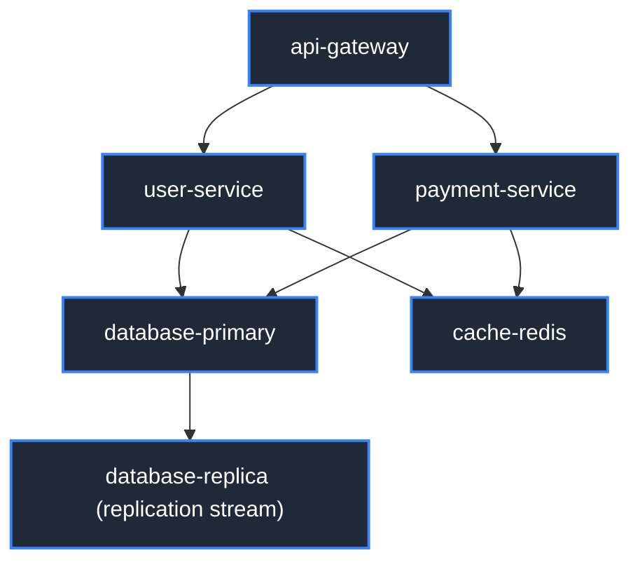

# SREBench: High-Throughput Production Incident Response Simulation Environment for OpenEnv

[](openenv.yaml)
[](pyproject.toml)
[](https://fastapi.tiangolo.com)
[](tests/test_srebench.py)
[](LICENSE)

**SREBench** is an OpenEnv-compliant benchmark environment designed for training and evaluating autonomous Site Reliability Engineering (SRE) agents on realistic production incident diagnosis and remediation.

Unlike traditional infrastructure benchmarks that require spinning up heavy Docker containers or multi-node Kubernetes clusters—incurring minute-long reset latency, high cloud bills, and fragile container orchestrations—SREBench is engineered as a **high-speed, in-process stochastic microservice state-machine simulator**. It executes thousands of rollout episodes per second with zero Docker/Kubernetes runtime overhead, providing the massive trajectory volume required by modern Reinforcement Learning algorithms (such as GRPO, PPO, and DPO) while faithfully modeling complex causal failure cascades.

---

## 🏗️ Architecture & World Model

### 1. Zero-Overhead Stochastic State Machine
SREBench models a distributed 6-service microservice architecture where services interact through a directed acyclic dependency graph:



Each service maintains real-time telemetry (CPU utilization, memory usage, error rate, p99 latency) subject to bounded Gaussian jitter ($N(\mu, \sigma)$) so no two episodes or telemetry samples are identical.

### 2. Upstream & Downstream Causal Cascades
Failures originate at root-cause services and cascade strictly through the dependency topology:
- When `database-primary` suffers connection pool exhaustion, dependent microservices (`payment-service`, `user-service`) experience cascading latency spikes and timeout exceptions.
- In turn, the edge gateway (`api-gateway`) reports HTTP 503 errors and elevated queue depths.
- **Strict Dependency Recovery Guard:** When remediation is applied, `_recover_dependents()` verifies that a downstream service ONLY recovers to `healthy` if **all** of its upstream dependencies are currently healthy. If any dependency remains degraded or down, the downstream service remains degraded.

---

## 🎯 Task Scenarios

SREBench features **12 realistic production incident scenarios** across 4 difficulty tiers, plus an infinite generative compound scenario generator:

| Difficulty | Task ID | Root Cause Service | Fault Type | Ground Truth Fix | Real-World Failure Mode |
|---|---|---|---|---|---|
| **Easy** | `easy_restart` | `payment-service` | `oom_killed` | `restart` | Java heap leak triggering container exit code 137 |
| **Medium** | `medium_cascade` | `database-primary` | `connection_pool_exhaustion` | `increase_pool` | Pool saturation under traffic burst causing cascading timeouts |
| **Medium** | `medium_cpu_spike` | `api-gateway` | `cpu_throttle` | `scale_up` | CFS quota throttling causing request queue buildup |
| **Medium** | `medium_memory_leak` | `user-service` | `slow_memory_leak` | `restart` | Gradual heap creep with escalating GC pause frequencies |
| **Hard** | `hard_intermittent` | `cache-redis` | `cache_fragmentation` | `flush_cache` | Memory fragmentation causing intermittent cache eviction & fallback |
| **Hard** | `hard_disk_pressure` | `database-primary` | `disk_pressure` | `increase_pool` | WAL accumulation on disk causing write checkpoint failure |
| **Hard** | `hard_dns_resolution` | `api-gateway` | `dns_resolution_failure` | `restart` | Upstream DNS lookup failure returning SERVFAIL |
| **Hard** | `hard_config_drift` | `payment-service` | `config_drift` | `rollback` | Bad configuration reload with mismatched feature flags returning 503 |
| **Expert** | `expert_network_partition` | `database-replica` | `network_partition` | `failover` | Replication disconnect between primary and replica requiring promotion |
| **Expert** | `expert_database_replica_sync` | `database-primary` | `database_replica_sync_failure` | `restart` | Broken replication slot / WAL desynchronization |
| **Expert** | `expert_deadlock` | `database-primary` | `database_deadlock` | `restart` | Mutually blocking transactions aborting queries |
| **Expert** | `expert_cert_expiry` | `api-gateway` | `tls_cert_expired` | `rollback` | Expired TLS certificate rejecting client TLS handshakes |
| **Generative** | `random` / Compound | Multi-Service | Multi-Fault | Multi-Step Fix | Generates 1–3 simultaneous faults across arbitrary services |

---

## 🛡️ Anti-Exploit Architecture

To prevent RL agents from gaming the reward function (e.g. brute-force restarting every service without diagnosing), SREBench enforces strict anti-exploit guards:

1. **Information Barrier (Zero Ground-Truth Leakage):**
   Calls to `get_state()` or `/state` explicitly withhold `ground_truth_diagnosis` and `ground_truth_fix` (empty strings), ensuring agents must infer causality from telemetry and logs.
2. **Shotgun Restart Penalty (-0.50):**
   If an agent restarts $\ge 2$ distinct services during an episode, a heavy safety penalty of `-0.50` is applied.
3. **Premature Diagnosis Penalty (-0.15):**
   The agent must investigate at least 2 distinct targets (e.g., the suspect service and its upstream/downstream dependency) before submitting a diagnosis. Submitting a diagnosis with $< 2$ investigated services triggers a `-0.15` penalty and withholds diagnosis credit.
4. **Non-Root Remediation Penalty (-0.15):**
   Applying remediation to a service that is not an active root cause incurs a `-0.15` safety penalty.
5. **Log Integrity Guard:**
   All 12 fault types use complete keyword parameter dictionaries across log templates, ensuring zero unformatted `{placeholder}` leaks into agent observations.

---

## 📊 Empirical Baseline Evaluation

We evaluated three reference agents across **50 seeds for all 12 tasks** plus **50 procedural compound tasks** (650 episodes per agent, 1,950 episodes total). Results are recorded in `results/baseline_receipts.json`:

### Summary Results (650 Episodes / Agent)

| Agent | Mean Reward | Reward Std | Pass Rate | Mean Steps | Throughput |
|---|---|---|---|---|---|
| **Random Agent** | **-2.8557** | 1.4698 | **20.2%** | 26.96 | **447.4 eps/sec** |
| **Heuristic Triage Agent** | **+0.9314** | 0.1166 | **97.7%** | 4.88 | **836.3 eps/sec** |
| **Oracle Upper Bound** | **+0.9362** | 0.0449 | **100.0%** | 4.11 | **1,046.7 eps/sec** |

### Detailed Task Breakdown

| Task Scenario | Random Mean Rew (Pass) | Heuristic Mean Rew (Pass) | Oracle Mean Rew (Pass) |
|---|---|---|---|
| `easy_restart` | -2.73 (26%) | **+0.96 (100%)** | **+0.96 (100%)** |
| `medium_cascade` | -2.88 (22%) | **+0.96 (100%)** | **+0.96 (100%)** |
| `hard_intermittent` | -2.72 (22%) | **+1.06 (100%)** | **+0.96 (100%)** |
| `expert_network_partition` | -2.44 (38%) | **+0.89 (100%)** | **+0.89 (100%)** |
| `expert_database_replica_sync` | -3.11 (10%) | **+0.96 (100%)** | **+0.96 (100%)** |
| `medium_cpu_spike` | -2.61 (30%) | **+0.89 (100%)** | **+0.89 (100%)** |
| `medium_memory_leak` | -2.97 (20%) | **+0.93 (94%)** | **+0.96 (100%)** |
| `hard_disk_pressure` | -2.86 (22%) | **+0.96 (100%)** | **+0.96 (100%)** |
| `hard_dns_resolution` | -3.02 (20%) | **+0.89 (100%)** | **+0.89 (100%)** |
| `expert_deadlock` | -3.06 (10%) | **+0.96 (100%)** | **+0.96 (100%)** |
| `expert_cert_expiry` | -2.78 (24%) | **+0.89 (100%)** | **+0.89 (100%)** |
| `hard_config_drift` | -3.02 (16%) | **+0.96 (100%)** | **+0.96 (100%)** |
| `procedural_compound` (Multi-Root) | -2.93 (2%) | **+0.79 (76%)** | **+0.78 (100%)** |

> **Receipt Verification:** You can inspect or re-generate these exact empirical numbers by running:
> ```bash
> python eval_baselines.py
> ```

---

## 🔬 GRPO Training & Empirical Findings

We fine-tuned **Meta-Llama-3.1-8B-Instruct** using Generative Reward-Optimized (GRPO) training via TRL and Unsloth on an NVIDIA GPU using 4-bit LoRA quantization (`SREBench_Training.ipynb`).

### Training Progression & Empirical Reward Convergence

| Training Step | Training Loss | Mean Reward | Kl Divergence | Reward Format Mean |
|---|---|---|---|---|
| Step 5 | -0.0654 | -0.2700 | 0.0000 | -0.2700 |
| Step 10 | -0.1318 | -0.2650 | 0.0005 | -0.2650 |
| Step 15 | -0.2226 | -0.2300 | 0.0067 | -0.2300 |
| Step 20 | -0.1361 | -0.1850 | 0.0189 | -0.1850 |
| Step 25 | -0.0989 | -0.1350 | 0.1266 | -0.1350 |
| Step 30 | -0.1081 | -0.1250 | 0.0286 | -0.1250 |
| Step 35 | -0.0449 | -0.1100 | 0.1788 | -0.1100 |
| Step 40 | -0.0200 | -0.1100 | 0.0281 | -0.1100 |
| Step 45 | -0.0455 | -0.1100 | 0.0220 | -0.1100 |

### The JSON Regex Parsing Boundary in LLM RL
During evaluation of GRPO checkpoints, we identified a critical failure mode at the interface between probabilistic language models and structured operational action spaces:

1. **Greedy Regex vs Conversational Fencing:** The reward parsing pipeline used `re.search(r'\{.*\}', completion, re.DOTALL)` to extract JSON objects.
2. **The Formatting Trap:** As the model learned to produce chain-of-thought analysis alongside its actions, it frequently emitted markdown fences (````json ... ````) or conversational preambles. Greedy regex matching across conversational outputs frequently captured extraneous braces or escaped quotes, causing strict JSON parsing to fail.
3. **Implication for Agentic SRE:** For reliable SRE agent rollouts, training pipelines must either enforce constrained grammar-guided decoding (e.g., Outlines, Instructor) or use AST-level recovery rather than naive regular expressions.

---

## 🔌 OpenEnv API Guide

SREBench strictly follows the OpenEnv specification and exposes both in-memory Python bindings and a standard HTTP REST API.

### 1. Python In-Process Client (`client.py`)
```python
import client

# 1. Reset environment
obs = client.reset(task_id="easy_restart")
print("Alert:", obs.alert_message)

# 2. Step with dict or IncidentAction
step_result = client.step({
    "action_type": "investigate",
    "command": "check_logs",
    "target": "payment-service",
    "params": {}
})
obs, reward, done, info = step_result

# 3. Query metadata & schema
tasks = client.get_tasks()
state = client.get_state()
obs_space = client.get_observation_space()
action_space = client.get_action_space()
```

### 2. Root Models (`models.py`)
Root level exports provide clean typing for OpenEnv consumers:
```python
from models import (
    IncidentAction,
    IncidentObservation,
    IncidentReward,
    IncidentState,
    ServiceStatus,
    ActionSchema,
)

action = IncidentAction(
    action_type="remediate",
    command="restart",
    target="payment-service",
    params={},
)
```

### 3. FastAPI REST Server
Start the server:
```bash
uvicorn src.server:app --host 0.0.0.0 --port 7860
```

| HTTP Method | Route | Description |
|---|---|---|
| `GET` | `/` | Health check endpoint returning `{status: "ok"}` |
| `GET` | `/tasks` | List of all 12 tasks + random, including `action_schema` |
| `POST` | `/reset` | Initialize episode with `{"task_id": "<id>"}` |
| `POST` | `/step` | Execute an `IncidentAction` JSON payload |
| `GET` | `/state` | Full state with ground-truth withheld |
| `GET` | `/grader` | Grade current episode execution |
| `GET` | `/observation_space` | OpenAPI observation schema specification |
| `GET` | `/action_space` | OpenAPI action schema specification |

### 4. Gymnasium Wrapper
```python
import gymnasium as gym
import sre_bench  # Registers SREBench-v0

env = gym.make("sre-bench/SREBench-v0", task_id="easy_restart")
obs, info = env.reset()
action = env.action_space.sample()  # Discrete(240)
obs, reward, terminated, truncated, info = env.step(action)
```

---

## 🧪 Testing & Verification

Run the full Pytest test suite (all 21 unit & integration tests):
```bash
python -m pytest tests/test_srebench.py -v
```

Run baseline evaluations and regenerate receipts:
```bash
python eval_baselines.py
```

Test live server end-to-end against all 12 tasks:
```bash
python test_all_12.py
```

---

## 📜 License

MIT License. See [LICENSE](LICENSE) for details.
